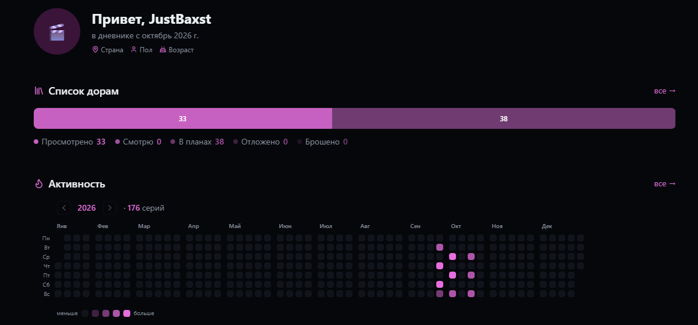
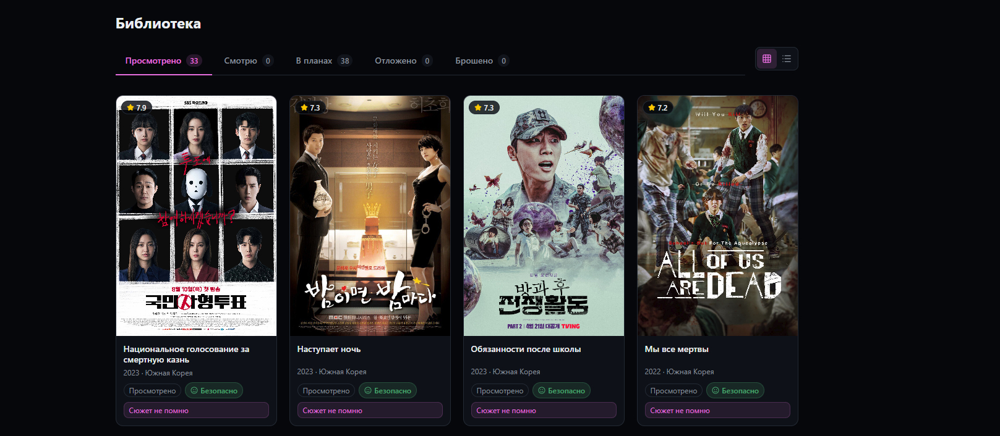
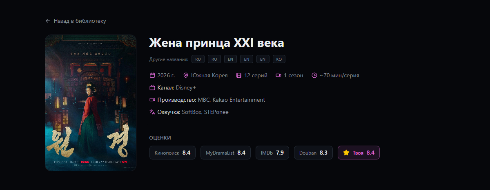
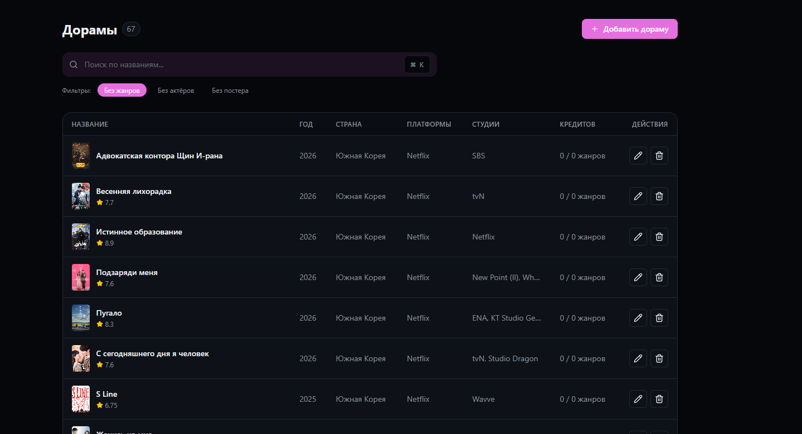
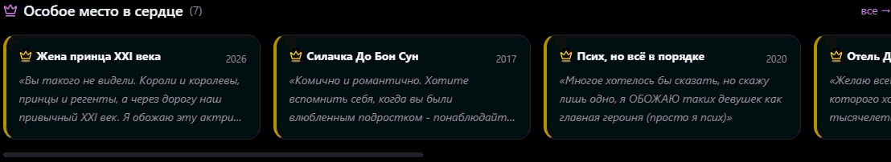

# 🦊 Crybam · 눈물밤

> **Где ночь встречает слёзы.**
> Модульный дневник для тихих людей, которые ценят эмоции, а не сухие рейтинги.

[](https://nextjs.org/)
[](https://www.prisma.io/)
[](https://www.typescriptlang.org/)
[](#)
[](#)
[](#)

---

### 🌙 О проекте

Crybam — это не просто трекер дорам. Это **личный дневник**, который адаптируется под ваше настроение. 
От «розового дневника с блёстками» до «строгого чёрного блокнота». 

Мы верим, что эмоции от просмотра так же важны, как и факты.

### ✨ Что внутри?

- 🎭 **Модульность:** настраивайте внешний вид и блоки под себя.
- 🕯 **Приватность:** 3 уровня скрытности (открытый, тихий, закрытый).
- 🏆 **Личные номинации:** вручайте Оскары своим любимым дорамам.
- 🌌 **Граф связей:** визуализация актёров и персонажей как звёздное небо.
- 🤖 **ИИ-помощник:** портрет зрителя на основе ваших отзывов.

---

## 📸 Скриншоты

> *Уютный дневник, который подстраивается под вас.*

<div align="center">
  <table border="0">
    <tr>
      <td align="center" width="50%">
        <b>🏠 Главная панель</b><br />
        
      </td>
      <td align="center" width="50%">
        <b>📚 Библиотека дорам</b><br />
        
      </td>
    </tr>
    <tr>
      <td align="center" width="50%">
        <b>🎬 Страница дорамы</b><br />
        
      </td>
      <td align="center" width="50%">
        <b>⚙️ Админ-панель</b><br />
        
      </td>
    </tr>
  </table>
</div>

<br />

<div align="center">
  <b>🕯 Инерционная карусель «Особое место»</b><br />
  <i>(Плавный скролл с инерцией и тактильным ощущением)</i><br /><br />
  <!-- Если гифка тоже в формате .gif, оставляем так. Если .mp4, придется использовать тег <video> -->
  
</div>

---

### 🛠 Технический стек

- **Фреймворк:** Next.js 16 (App Router)
- **База данных:** Prisma 6 + SQLite (в планах PostgreSQL)
- **Стили:** Tailwind CSS v4
- **Язык:** TypeScript

---

### 🚀 Запуск проекта

1. Клонируйте репозиторий:
```bash
git clone https://github.com/JustBaxst/crybam.git

---

### 👨‍💻 Автор

**JustBaxst (Дима)**  
*Из Беларуси с любовью к азиатской культуре.*

### 📄 Лицензия

Copyright (c) 2026 JustBaxst. All rights reserved.